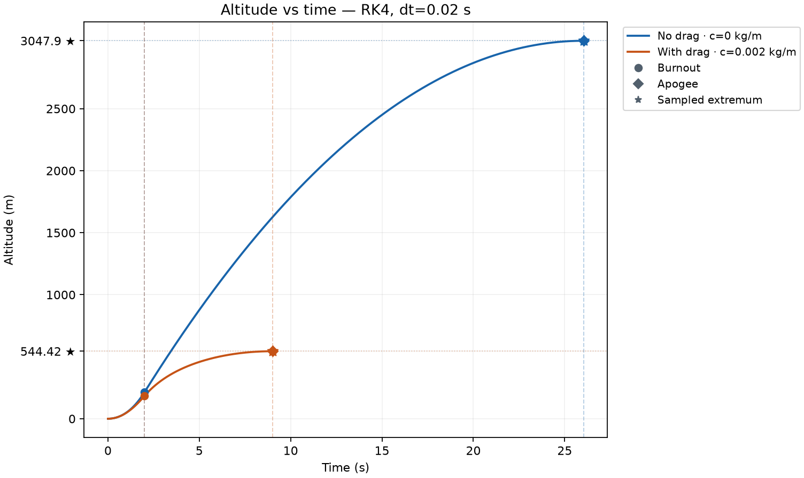
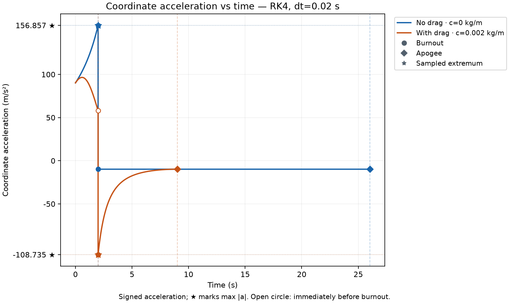

# Actual CLI example — C5 Rocket V3.1

Historical run: WSL Ubuntu / Python 3.13.14, recorded at `2026-10-28T08:39:10.067323+00:00` (UTC). This English edition translates its captions/notes and redraws plots from the stored numerical data; it does not change the run's timestamp or numerical results.

```bash
python main.py compare --method rk4 --dt 0.02 --c 0.002
```

The command exited with code 0. Parameters: m0=1 kg, mf=0.6 kg, q=0.2 kg/s, ve=500 m/s, g=9.81 m/s², h0=v0=0. RK4 uses dt=0.02 s; only c differs between cases. Reference solutions do not replace simulated output.

| Quantity | No drag | With drag |
|---|---:|---:|
| Burnout time (s) | 2.000000 | 2.000000 |
| Burnout altitude (m) | 214.141564 | 183.592580 |
| Burnout velocity (m/s) | 235.792812 | 172.271882 |
| Apogee (m) | 3047.895394 | 544.419764 |
| Time to apogee (s) | 26.035965 | 8.999454 |
| Peak &#124;a&#124;/g | 15.989467 | 11.084132 |

The peak is coordinate acceleration magnitude divided by g, including samples and both burnout limits. For the drag case its largest magnitude occurs on the negative-acceleration side; the plot retains that sign. Apogee is absolute altitude h in this model.

Files from this run:

- [Parameters, events and results](../outputs/quick_runs/20261028T083910_067323Z_compare_c86689ea/results.json).
- [Summary CSV](../outputs/quick_runs/20261028T083910_067323Z_compare_c86689ea/summary.csv).
- [No-drag CSV](../outputs/quick_runs/20261028T083910_067323Z_compare_c86689ea/no_drag.csv), [drag CSV](../outputs/quick_runs/20261028T083910_067323Z_compare_c86689ea/with_drag.csv).
- [Altitude](../outputs/quick_runs/20261028T083910_067323Z_compare_c86689ea/altitude.png), [velocity](../outputs/quick_runs/20261028T083910_067323Z_compare_c86689ea/velocity.png), [acceleration](../outputs/quick_runs/20261028T083910_067323Z_compare_c86689ea/acceleration.png), [mass](../outputs/quick_runs/20261028T083910_067323Z_compare_c86689ea/mass.png).





The original V3.1 validation also ran no-drag and with-drag separately and confirmed that all 150 previously existing files were unchanged by the three manual runs. See outputs/usability/quick_runs_validation.json and the translated historical logs.

To repeat through the menu: run `python main.py`, select 3, press Enter for method, dt, c and default parameters, then choose 0 to exit. A new directory and timestamp will be created. Quick runs do not automatically perform verification.

English-edition rerun logs and preservation comparisons are in `outputs/english_validation/`. Historical V3.1 evidence is in `outputs/usability/VALIDATION_V3_1.md`.
