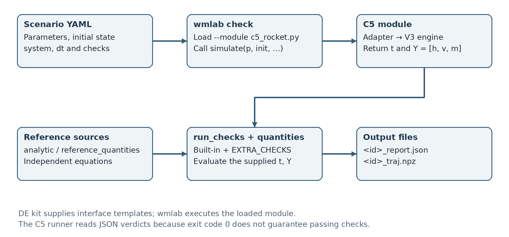

# Integration with wmlab 0.1.1

The supplied archive was integrated on 27 October 2026. This English edition translates toolkit text; the original 38-file hash manifest remains intact and a separate localization manifest checks the translated source and installed package. No numerical check or threshold was changed to alter a verdict. The supplied ZIP has no separate report answer template. Group names and student IDs are already recorded in the project YAML files and both system cards.

## 8. DE kit and wmlab: distinct roles

### 8.1. DE kit provides the project structure

The DE kit is the Differential Equations Project Starter Kit distributed with the course material. It contains Python and YAML templates and a complete worked example. The supplied example concerns cooling; its equations and parameters are not used as the C5 rocket model.

| DE kit file | Template content | Use in C5 |
|---|---|---|
| template_system.py | Interface for a simulation system | Interface contract for c5_rocket.py |
| scenario_template.yaml | Structure of a scenario | C5 YAML files under scenarios/wmlab/ |
| system_card_template.yaml | Model and dataset description | Basis for system_card.yaml |
| example_cooling.py | Complete example module | Reference for function organization and EXTRA_CHECKS |
| scenarios/cooling_*.yaml | Two passing cases and one deliberate failure | Example of scenario-set design |

The DE kit does not calculate C5 altitude by itself. Its templates standardize function names, parameter structures, outputs and model documentation. The existing C5 integrator already handles burnout and apogee, so it is retained. c5_rocket.py adapts that engine to the required interface instead of copying the uniform-grid loop from the cooling example.

### 8.2. wmlab executes and verifies simulations

The toolkit README describes wmlab as a physics-law-based World Model toolkit. In this project, it is a Python package with commands for reading scenarios, loading system modules, calling simulations, running checks and saving results. It is not a machine-learning model predicting the rocket trajectory, and running check or dataset does not train a neural network.

| wmlab command | Purpose | Output |
|---|---|---|
| systems | List registered systems | Terminal listing |
| validate | Check scenario structure and system registration | Validity message or errors |
| check | Run the simulator, checks and quantities | *_report.json and *_traj.npz |
| dataset | Sample parameters and call the simulator repeatedly | NPZ file containing trajectories |
| collect | Summarize reports and sharing eligibility | registry.csv |

The V3 workflow uses validate, check and dataset. collect is not part of the current verification workflow. Its availability does not imply that any dataset has been uploaded to an online registry.

### 8.3. Which capabilities come from the kit and which from C5?

The toolkit provides module loading, the scenario schema, general-purpose checks and report/dataset serialization. C5 provides the rocket equations, event handling, parameters, reference solutions and three custom checks: trajectory_reference, dynamics_consistency and event_consistency. Reliable results therefore depend on both the physical module and the verification design, not merely on a wmlab command completing.

Not every available check is appropriate for C5. For example, the rocket's mechanical energy cannot be required to remain constant throughout powered flight: the motor supplies energy, mass changes and drag dissipates energy. Checks must follow the applicable equations and flight phase rather than being enabled indiscriminately.

The project uses wmlab 0.1.1 from the supplied starter kit. The source is retained in vendor/starter_kit/. In this English edition, verify_vendor compares bundled and installed files with the localization hashes and retains the original hashes separately for provenance. Adding C5 does not require modifying wmlab's source or permanent registry because this version supports --module.

## 9. How c5_rocket.py connects the two interfaces

### 9.1. Two simulate signatures

The internal interface and the toolkit interface accept and return different objects:

```python
# Internal C5 interface
r = rocket.simulate(params, dt=0.02, method="rk4")
# r is a Trajectory, including a and Event objects

# Interface required by wmlab
t, Y = c5_rocket.simulate(p, init, t_span, dt)
# t has shape (N,); Y has shape (N, 3)
```

The adapter declares NAME = "c5_rocket" and STATE = ["h", "v", "m"]. Its parameters function converts the p and init dictionaries into Parameters, separating method and output_mode from the physical parameters. Unsupported keys are rejected to prevent a misspelled parameter name from silently falling back to a default.

### 9.2. Functions called by the toolkit

| Function or declaration | Role in C5 |
|---|---|
| simulate(p, init, t_span, dt) | Call the V3 engine and return t and Y in the required form |
| analytic(p, init, t) | Return the no-drag solution; return None for c > 0 |
| quantities(p, init, t, Y) | Extract quantities from the supplied observations |
| sample(rng) | Draw admissible random configurations for the dataset |
| reference_quantities(p, init) | Provide analytical or independent DOP853 values |
| bounds(p) | Specify h ≥ 0, v ≥ 0 and m_f ≤ m ≤ m_0 |
| EXTRA_CHECKS | Register the three C5-specific checks |

With --module c5_rocket.py, wmlab loads the file using importlib, checks for the required functions and registers the module under NAME. The YAML entry system: c5_rocket then determines which module to call.

### 9.3. Two adapter output modes

The events mode returns the complete history containing burnout and apogee if the requested end time is beyond the apex. If a shorter horizon is requested, it returns the history up to that exact time. This supports the convergence check at 1.5 s. A scenario specifying t_span = [0, 40] does not force the ascent model to run for 40 s: it stops earlier when apogee is reached.

The fixed_grid mode supplies common observation times for the dataset. The simulator still computes the complete ascent first, after which _sample_at evaluates the numerical trajectory on the requested grid. If a time is not already stored, it takes a shortened step from the preceding observation using the same Euler, Heun or RK4 method. Because the underlying history contains burnout, that shortened step does not cross the phase boundary. DOP853 is not used to fill the dataset, and linear interpolation is not used to reduce RK4's sampling accuracy.

fixed_grid requires the horizon to precede apogee and to be divisible by dt within tolerance. Invalid requests raise an error; the adapter does not extend the last state or repeat rows to force an acceptable shape.

### 9.4. Avoiding hidden replacement of incorrect observations

observed_trajectory reconstructs Event and Trajectory objects from the actual supplied t and Y. quantities does not rerun the reference simulator to obtain better-looking values. If a test changes the final row of Y, quantities must reflect that change. A history without an exact burnout observation or a final apogee state is rejected.

The current wmlab contract contains only h, v and m. Acceleration needed for some quantities is derived from the ODE when reconstructing the Trajectory; it is therefore not an independently observed acceleration channel. The custom checks explicitly omit the circular algebraic check that would compare this derived acceleration with the same equation. To verify acceleration exported by Member B, the local Trajectory interface must receive that separate a channel.

## 10. From a wmlab scenario to its output files

### 10.1. Reading a C5 scenario

c5_baseline_drag.yaml contains the following information groups:

| Field | Meaning in the baseline case |
|---|---|
| id | Unique identifier used in report and trajectory filenames |
| author, course | Group information and the DE course |
| system | c5_rocket, matching the module's NAME |
| params | m0, mf, q, ve, g, c and method |
| initial | h0 and v0 |
| t_span, dt | Requested time interval and time step |
| checks | Checks and their configured tolerances |
| license, consent_physeval | License and sharing metadata; assistance is disclosed in the report |

For the drag case, checks includes reference_match, within_bounds and the three C5 EXTRA_CHECKS. reference_match uses a tolerance of 10⁻⁶; within_bounds uses 10⁻⁸. The custom checks retain quantity-specific tolerances from TrajectoryTolerances rather than applying one numerical threshold to metres, metres per second and kilograms.

### 10.2. Actual commands

From the project root, individual steps can be run as follows:

```bash
python -m wmlab --lang en validate \
  scenarios/wmlab/c5_baseline_drag.yaml --module c5_rocket.py

python -m wmlab --lang en check \
  scenarios/wmlab/c5_baseline_drag.yaml --module c5_rocket.py \
  -o outputs/wmlab
```

validate checks the scenario structure and selected constraints. A valid-scenario message does not establish simulation correctness. check is the command that actually calls the simulator and verification functions.



Specifically, cmd_check loads the scenario, resolves its module from REGISTRY, calls simulate, converts Y to a numerical array, calls run_checks and quantities, and writes two files. run_checks combines the built-in CHECKS with the module's EXTRA_CHECKS. Each check returns name, passed, value, threshold and note. Custom checks additionally return details containing their individual subchecks.

### 10.3. Reading the JSON report and NPZ trajectory

For the baseline scenario ID, the two main output files are:

```text
outputs/wmlab/de-c5-baseline-drag-group_report.json
outputs/wmlab/de-c5-baseline-drag-group_traj.npz
```

The JSON file stores the verdict, checks, quantities and metadata. The NPZ file stores t and Y from that simulation. The following values are taken from the saved report:

| Check | passed | value | threshold |
|---|---|---:|---:|
| reference_match | true | 3.878441×10⁻¹⁰ | 10⁻⁶ |
| within_bounds | true | 0 | 10⁻⁸ |
| trajectory_reference | true | 0 | 0 |
| dynamics_consistency | true | 0 | 0 |
| event_consistency | true | 0 | 0 |

The meaning of value depends on the check. For reference_match, it is the largest relative discrepancy among the reference quantities. For the three custom checks, it is the number of failed subchecks. Consequently, value = 0 for a custom check does not imply that all numerical errors are zero; the actual errors are reported in details.

### 10.4. Why scripts/wmlab_verify.py is needed

wmlab 0.1.1 may finish with exit code 0 even when its report contains a failed check. The project's runner therefore reads the JSON verdict and individual checks rather than relying only on the process exit status.

For the deliberate-failure case, the runner requires reference_match to fail with a finite value. A missing function or exception does not count as successful detection of the intended numerical error. For convergence_order, the toolkit checks a lower bound on the measured order; the runner additionally requires a finite order within 0.5 of the theoretical value.

run_official performs the following sequence: verify toolkit hashes; validate and check the three scenarios; run three convergence scenarios; perform 12 mutations; generate the dataset; verify the complete dataset; write the summary and update measured fields in system_card.yaml. It does not modify toolkit source or official scenario YAML files to make the checks pass.

## 11. Dataset generation and data access

### 11.1. The official dataset generated by wmlab

The runner uses this command:

```bash
python -m wmlab --lang en dataset --system c5_rocket \
  --module c5_rocket.py --n 200 --seed 20261027 \
  --stride 1 -o c5_rocket.npz
```

wmlab initializes a random-number generator with the specified seed. Each iteration calls sample(rng) to obtain params, initial, t_span and dt, then calls simulate and collects Y. Once the trajectories have equal shapes and contain no NaN or infinity values, the toolkit stacks them into a larger array and saves the NPZ file.

The dataset command itself does not run all scenario checks on every sample. The project's verify_dataset step performs the independent reference comparison for all 200 segments and checks their shape, time grid, state names and physical bounds. Successfully creating a dataset file and verifying its contents are separate steps.

### 11.2. Sampling domain and common time grid

| Sampled quantity | Range or construction |
|---|---|
| m0 | Uniform from 0.8 to 1.2 kg |
| Propellant mass fraction | Uniform from 0.25 to 0.45 |
| mf | m0 multiplied by the remaining mass fraction |
| ve | Uniform from 400 to 550 m/s |
| Initial thrust-to-weight ratio | Uniform from 1.2 to 15 |
| q | Thrust-to-weight ratio × m0 × 9.81 / ve |
| c | Uniform from 0 to 0.003 kg/m |
| g; h0; v0 | 9.81 m/s²; 0 m; 0 m/s |
| Method and time grid | RK4; 0–4 s; dt = 0.02 s |

This domain is intended for numerical testing and has not been established as a distribution of real motors. There are 201 times because both t = 0 and t = 4 are included: 4/0.02 + 1 = 201. STATE contains three variables, so Y has shape (200, 201, 3). The seed makes the parameter draws reproducible, while stride = 1 retains every observation. Omitting stride uses the toolkit default of 10 and changes the number of saved times.

These are 200 ascent segments on a shared grid, not 200 flights each ending at apogee. In the saved dataset, burnout times range from approximately 0.801 s to 14.391 s. Some 0–4 s segments contain both phases; others are still powered when the segment ends. The final row at t = 4 s must not be labelled as apogee.

### 11.3. Reading the NPZ file

```python
import json
import numpy as np

with np.load("c5_rocket.npz", allow_pickle=False) as data:
    t = data["t"]                 # (201,)
    Y = data["Y"]                 # (200, 201, 3)
    meta = json.loads(str(data["meta"]))
    state = json.loads(str(data["state"]))
    system = str(data["system"])

height_of_first_segment = Y[0, :, 0]
velocity_of_first_segment = Y[0, :, 1]
mass_of_first_segment = Y[0, :, 2]
parameters_of_first_segment = meta[0]["params"]
```

NPZ is not a text table that can be opened directly in Excel. A segment can be exported to CSV using NumPy when needed. Units and column order should be read together with STATE and the system card, rather than inferred from array positions alone.

### 11.4. How the local dataset differs

outputs/local_dataset_200.npz stores 200 complete ascents to apogee, with different lengths. The t, y and a arrays are concatenated, and offsets identifies each flight's index range. This dataset uses seed 20261024 and dt = min(0.04, t_b/100). It does not have the fixed shape (200, 201, 3).

The local dataset provides complete-flight and acceleration information, while the wmlab dataset satisfies the toolkit's common-grid contract. Local generation checks physical constraints. The recorded independent comparison of all 200 segments applies specifically to the wmlab dataset; the two datasets should not be described as having identical verification coverage.


## Reproduction and safeguards

From the project root after installing requirements:

```bash
python -m scripts.wmlab_verify
python -m scripts.reproduce
```

The first command validates/checks three scenarios, runs three convergence YAML files, generates 200 segments with the real CLI, independently reloads/checks them, runs 12 h/v/m mutations, updates measured orders in system_card.yaml and saves logs/summary. The second also runs local tests/studies and creates reports.

All three custom checks consume the supplied t,Y arrays; they never rerun the simulator or use a stale cached trajectory to hide a mutation. `quantities` also reads the supplied observations. No `energy_conserved` check is declared for the rocket because mechanical energy is not conserved during burn or with drag.

Built-in analytical convergence uses the first two errors even though it runs three step sizes, and only checks a lower bound. The C5 runner requires finite p and |p−expected|≤0.5 as well. The separate local study fits four steps and includes event quantities. Built-in analytic_match uses a global state scale, so custom trajectory_reference retains unit-specific per-field checks.

For scenario output, `events` mode preserves burnout and apogee. For dataset output, `fixed_grid` uses [0,4] s at dt=0.02; off-grid observations are recomputed with the selected numerical method and correct phase. Events with draw-dependent times are not inserted into the common grid. A draw reaching apogee by 4 s is rejected; it is not padded. The dataset command uses stride=1.

The official interface exports h,v,m only. Algebraically reconstructed acceleration is used for quantities but is not presented as an independently measured channel. Use the local Trajectory adapter to verify Member B acceleration. Local mutations cover 16 h/v/m/a cases; toolkit mutations cover 12 h/v/m cases.

The report retains the assistance disclosure; project metadata retain consent_physeval=false and ALL-RIGHTS-RESERVED. No upload, registry submission or publication is performed.
