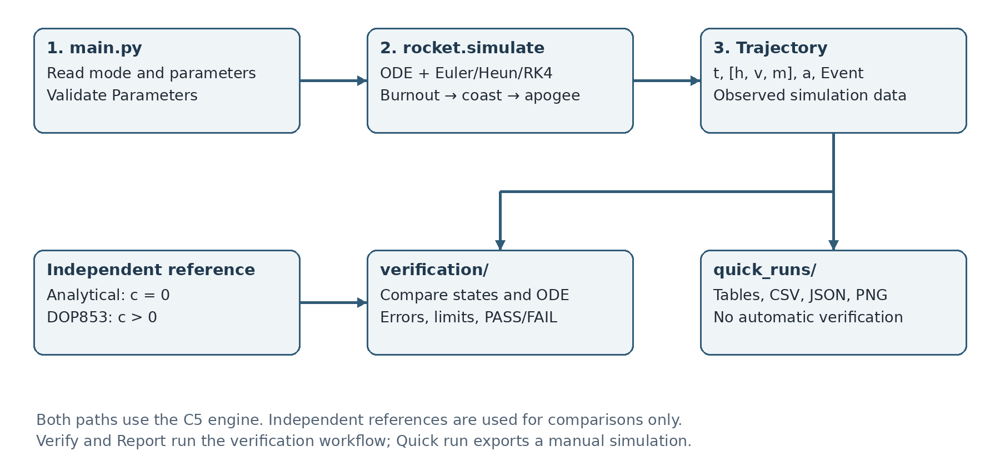
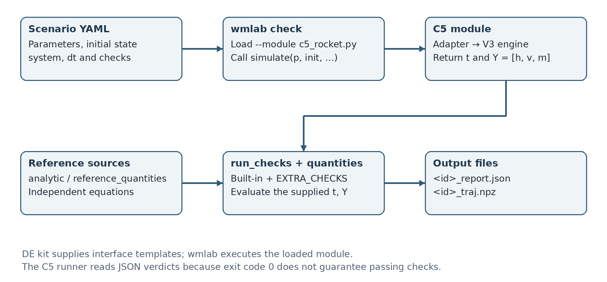
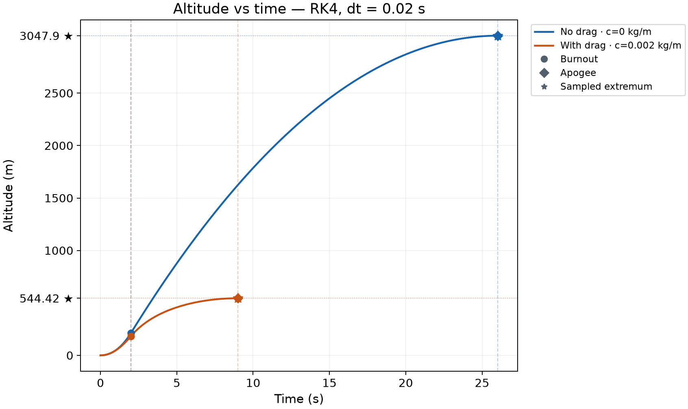
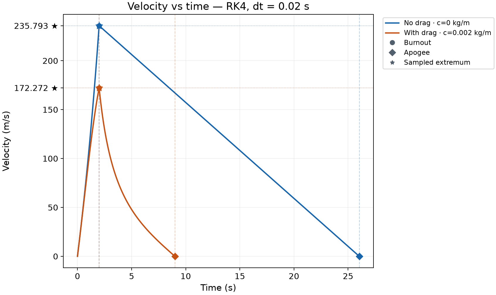
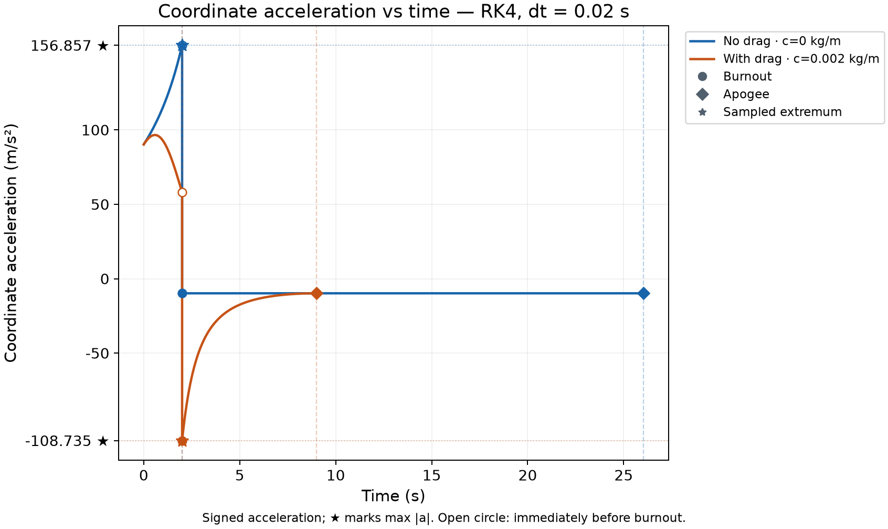
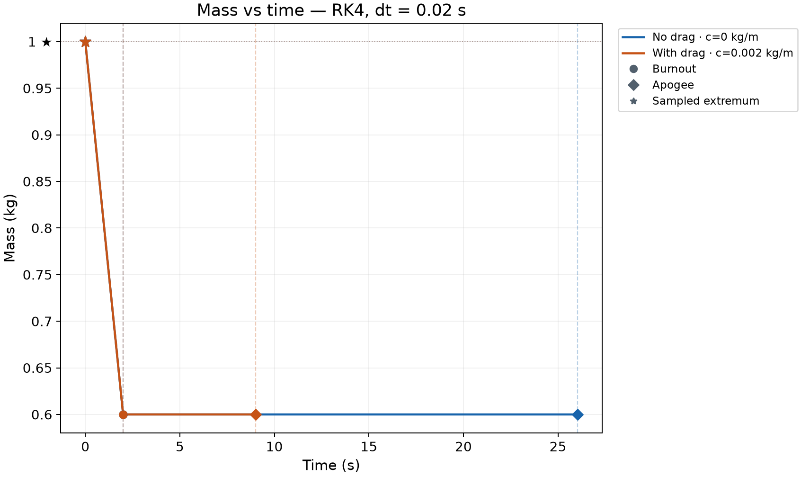
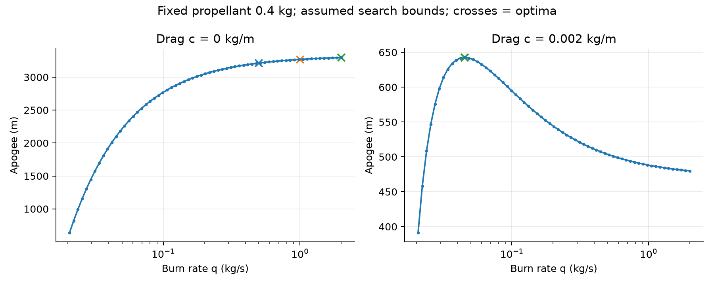

# SIMULATION AND VERIFICATION OF THE C5 MODEL ROCKET

Technical Report — C5 Rocket V3.1

Course: Differential Equations

Group: ....................................................................

Student names and IDs: .....................................................

Instructor: ...............................................................

Report date: 2 November 2026

## Abstract

This project examines the vertical motion of a rocket whose mass decreases as propellant is consumed. The program calculates altitude, velocity, mass and acceleration from the initial state to apogee. Euler, Heun and fourth-order Runge–Kutta methods solve the same differential equation system, allowing the effects of the numerical method and time step to be assessed.

The project also includes a verification framework that checks both characteristic flight quantities and observations inside the trajectory. The no-drag case is compared with an analytical solution, while the drag case is compared with an independent DOP853 numerical reference. Deliberately corrupted copies of trajectories are used to test whether the verification framework can detect errors.

Version V3.1 adds a command-line interface in main.py while retaining the V3 computational core. The starter kit is integrated through c5_rocket.py, which implements the DE kit interface. wmlab 0.1.1 loads this module to execute scenarios, check results and generate a dataset. The stored execution evidence records 166 passing tests, three scenarios with the expected outcomes, three passing convergence reports and 200 trajectory segments checked against an independent reference.

This report describes the existing source code and uses V3.1 execution evidence saved on 28 October 2026. The report date does not represent a new simulation run. Numerical tables are drawn from the project's CSV and JSON files. Figures show computed data, not measurements from an actual rocket flight. This English edition preserves the technical scope and numerical results of the Vietnamese report; figure labels have been translated using the same saved data.

## 1. Problem, objectives and scope

### 1.1. Questions addressed

The C5 problem asks for the velocity and altitude at burnout, maximum altitude, time to apogee and peak acceleration. Adding aerodynamic drag requires an explanation of how the trajectory changes. Changing the time step or numerical method requires an error assessment, rather than simply checking whether the plotted curve looks plausible.

The project serves two purposes. First, it provides a standalone reference simulator. Second, it provides the verification framework for Member C, with an adapter interface for evaluating Member B's official simulator. Simulation and verification therefore occupy separate groups of modules, and the reference calculations are independent of the integration algorithm under test.

### 1.2. Assumptions and limitations

The rocket moves vertically, with the positive direction pointing upward. Gravitational acceleration g, drag coefficient c, propellant consumption rate q and exhaust velocity v_e are treated as constants. Drag magnitude is proportional to the square of velocity. After the propellant is exhausted, thrust becomes zero and mass remains at m_f.

The model ends at apogee, the highest point of the trajectory. It does not simulate descent, parachute deployment, crosswind, rotation, changing atmospheric density or a measured motor thrust curve. The condition q·v_e > m_0·g is checked when the parameter object is created. A rocket remaining on the launch pad before liftoff is outside the model's scope.

### 1.3. Baseline parameters

| Quantity | Symbol / code name | Value | Unit |
|---|---|---:|---|
| Initial mass | m_0 / m0 | 1.0 | kg |
| Mass after burnout | m_f / mf | 0.6 | kg |
| Propellant consumption rate | q | 0.2 | kg/s |
| Exhaust velocity | v_e / ve | 500 | m/s |
| Gravitational acceleration | g | 9.81 | m/s² |
| Drag coefficient | c | 0 or 0.002 | kg/m |
| Initial conditions | h0, v0 | 0; 0 | m; m/s |
| Baseline time step | dt | 0.02 | s |

Here, c has units of kg/m. It should not be confused with the dimensionless aerodynamic drag coefficient C_D. These values define a numerical test problem; they are not parameters calibrated for a particular motor.

## 2. Mathematical model and reference solutions

### 2.1. First-order system formulation

The state vector is y(t) = [h(t), v(t), m(t)]. This representation allows all three numerical methods to use the same right-hand-side function f(t, y). The function returns the rate of change of the state, not the state at the next time step.

The burnout time follows from the mass law:

```text
t_b = (m_0 - m_f) / q
m(t) = m_0 - q·t         for 0 ≤ t ≤ t_b
m(t) = m_f               for t > t_b
```

For the baseline configuration, t_b = (1 − 0.6)/0.2 = 2 s. During powered flight, thrust is T = q·v_e = 100 N. The governing equations are:

```text
h' = v
v' = q·v_e/m - g - c·v·|v|/m
m' = -q
```

After burnout:

```text
h' = v
v' = -g - c·v·|v|/m_f
m' = 0
```

The term v·|v| preserves the direction of drag. During ascent, v ≥ 0, so v·|v| = v². At t = 0 under the baseline initial conditions, acceleration is 100/1 − 9.81 = 90.19 m/s². The initial right-hand side is therefore [0, 90.19, −0.2].

### 2.2. Analytical solution without drag

Set c = 0 and substitute m(t) = m_0 − qt into the velocity equation.

Integrating v' = q·v_e/(m_0 − qt) − g from 0 to t gives a thrust contribution of v_e·ln[m_0/(m_0 − qt)]. Integrating v(t) then gives h(t). The substitution u = m_0 − qt reduces the logarithmic integral to the form u·ln(u) − u. Integration constants are determined by h(0) = h_0 and v(0) = v_0. The resulting expressions are:

```text
v(t) = v_0 + v_e·ln(m_0 / m(t)) - g·t
h(t) = h_0 + v_0·t
       + (v_e/q)·[m_0 - m(t) - m(t)·ln(m_0/m(t))]
       - g·t²/2
```

These expressions apply during the burn. Evaluating them at t = t_b gives h_b and v_b. During coast, let τ = t − t_b:

```text
h(t) = h_b + v_b·τ - g·τ²/2
v(t) = v_b - g·τ
m(t) = m_f
τ_apogee = v_b/g
h_apogee = h_b + v_b²/(2g)
t_apogee = t_b + v_b/g
```

The solution checks the events and provides h, v and m at every exported time. In rocket/analytic.py, log1p improves logarithm evaluation when its argument would otherwise be close to 1. When x = qt/m_0 is very small, x + (1−x)ln(1−x) is evaluated using the sum xⁿ/[n(n−1)] for n from 2 to 8. This reduces cancellation between nearly equal numbers. It is a numerical evaluation of the same analytical expression.

### 2.3. Independent numerical reference with drag

For c > 0, verification/independent.py calls SciPy's solve_ivp with DOP853 and rtol = atol = 2×10⁻¹². The reference solves for h and v, while mass is evaluated algebraically from the piecewise linear mass law. Burn and coast are integrated separately. The initial coast state comes from the reference solution's own burn endpoint.

This module does not call rocket.rhs or the simulator's Euler, Heun or RK4 implementations. That separation reduces the risk that both sides of a comparison repeat the same implementation error. DOP853 is nevertheless a numerical reference with finite error, not an exact solution. The verification tolerances are much larger than the numerical error expected from this reference calculation.

The coast phase with drag and constant mass also has an analytical relation. With k = c/m_f:

```text
Δh_coast = ln(1 + k·v_b²/g) / (2k)
Δt_coast = atan(v_b·sqrt(k/g)) / sqrt(gk)
```

If h_b and v_b are taken from the simulated trajectory, this relation checks coast propagation only. It cannot establish that the preceding burn phase was correct.

## 3. Numerical algorithms and event handling

### 3.1. Euler, Heun and RK4

The integration steps are implemented in rocket/methods.py. Each function receives f, t, y and dt and returns an updated state vector. The simulator manages the time loop.

| Method | Idea behind one step | Evaluations of f | Expected global order |
|---|---|---:|---:|
| Euler | Use the derivative at the start of the step | 1 | 1 |
| Heun | Predict with Euler, then average two derivatives | 2 | 2 |
| RK4 | Combine four evaluations at the start, midpoint and end | 4 | 4 |

With Δt denoting the current step size, the formulas are:

```text
Euler:
    y_next = y + Δt·f(t, y)

Heun:
    k1 = f(t, y)
    k2 = f(t + Δt, y + Δt·k1)
    y_next = y + Δt·(k1 + k2)/2

RK4:
    k1 = f(t, y)
    k2 = f(t + Δt/2, y + Δt·k1/2)
    k3 = f(t + Δt/2, y + Δt·k2/2)
    k4 = f(t + Δt, y + Δt·k3)
    y_next = y + Δt·(k1 + 2k2 + 2k3 + k4)/6
```

For example, Euler with dt = 0.02 s and the baseline initial state gives h = 0 m, v = 1.8038 m/s and m = 0.996 kg after its first step. Altitude is still zero because Euler uses the initial velocity, which is zero. This is a property of the approximation; it does not mean that the physical rocket remains stationary for the entire first 0.02 s. Heun and RK4 use additional evaluations within the step and represent the increasing velocity more accurately.

### 3.2. Burnout: ending a step at the equation switch

Thrust changes from q·v_e to zero at t_b. If an RK4 step crosses this point without special handling, its intermediate stages may mix the two phases and reduce accuracy.

In rocket/simulator.py, a step whose proposed endpoint t + dt reaches or exceeds t_b is shortened to Δt = t_b − t. Every stage in that step uses the powered equation, including the endpoint stage. The following step uses the coast equation. At burnout, mass is set to m_f only after its discrepancy has been checked against the allowed limit. This corrects roundoff at a known phase boundary.

The state variables h, v and m are continuous through burnout, but acceleration has different left and right limits. The Event object stores a_before and a_after so that the acceleration immediately before engine shutdown is not lost.

### 3.3. Apogee: locating v = 0

During coast, if a trial step produces nonpositive velocity, the simulator knows that apogee lies within that step. The _apogee_step function bisects its duration. For each trial duration, it integrates again from the same left-hand state using the selected numerical method. Bisection stops when the time interval is sufficiently small; the default event_tol is 10⁻¹² s.

This approach does not merely select the largest altitude sample or linearly interpolate between the final two samples. It keeps event handling consistent with the integration method. Error accumulated before the event remains present: a small event-location tolerance does not imply that the entire solution is accurate to 10⁻¹².

### 3.4. Error conditions that stop integration

The simulator rejects steps with nonfinite states, nonpositive intermediate mass, violations of the ascent conditions or an unphysical increase in coast velocity. It also checks the maximum number of steps and whether the time step is so small that t + Δt equals t in floating-point arithmetic. On failure, it raises NumericalError rather than presenting an incomplete trajectory as a successful result.

## 4. Program architecture and function flow

### 4.1. Responsibilities of the main files

| Component | Main responsibility |
|---|---|
| main.py | Read selections, validate CLI input and dispatch the requested mode |
| rocket/model.py | Parameters, admissible parameter domain and ODE right-hand side |
| rocket/methods.py | One Euler, Heun or RK4 step |
| rocket/simulator.py | Time loop and burnout/apogee handling |
| rocket/interface.py | Event, Trajectory and quantities |
| rocket/analytic.py | No-drag analytical formulas and coast relations |
| verification/ | Reference comparisons, ODE checks, scenarios, convergence and mutations |
| experiments/quick_runs.py | Tables, CSV/JSON and four plots for manual simulations |
| experiments/studies.py | Burn-rate, step-size and peak-acceleration studies; local dataset |
| scripts/ | Verification, report reproduction and packaging workflows |
| c5_rocket.py | Adapter between the simulator and wmlab |
| vendor/starter_kit/ | Unmodified DE kit and wmlab source |



### 4.2. Tracing a Compare command

Consider the command:

```bash
python main.py compare --method rk4 --dt 0.02 --c 0.002
```

build_parser reads mode, method, dt and the physical parameters. execute creates a Parameters object, whose validation checks the physical constraints. run_quick then calls calculate to construct two configurations that differ only in c: zero and 0.002.

Each configuration is passed to rocket.simulate. The simulator selects a step function from METHODS, initializes the state, and integrates to burnout and then apogee. It packages the result as a Trajectory. The quantities function extracts the requested summary values directly from that trajectory and its two events.

Once both simulations finish, run_quick creates a new directory, writes the data, produces plots and prints a table to the terminal. It does not use the analytical solution or DOP853 to fill the simulation output. results.json is written last, after all other exports succeed.

### 4.3. Five modes at a single entry point

| Command | Implementation called | Main output |
|---|---|---|
| no-drag | run_quick with c = 0 | One trajectory and presentation files |
| with-drag | run_quick with c > 0 | One trajectory with drag |
| compare | run_quick with two configurations | Comparison tables and plots |
| verify | pytest, local checks and the wmlab runner | Standard verification evidence |
| report | scripts.reproduce | Studies, verification, datasets and the standard report |

Without arguments, main.py opens an interactive menu. Commands with a subcommand are suitable for automation and do not ask further questions. Child modules run with the current Python interpreter and the project root as their working directory. A failed step propagates its error instead of being converted into a success message.

## 5. Data representation and exported results

### 5.1. What is a Trajectory?

Trajectory stores the history together with the two events. The h, v and m properties provide convenient access to the three columns of y; they are not separate recalculations.

| Field | Data shape or type | Meaning |
|---|---|---|
| t | Array (N,) | Time of each observation |
| y | Array (N, 3) | Columns h, v, m in that order |
| a | Array (N,) | Coordinate acceleration; the coast-side value at burnout |
| burnout, apogee | Event | Time, state and one-sided accelerations |
| params | Parameters | Parameters used in the run |
| method, dt | String, number | Method and requested time step |
| diagnostics | List | Optional diagnostic information |

The sample count N depends on the time to apogee. In addition to ordinary steps of size dt, shortened steps occur at burnout and apogee. It is therefore incorrect to assume that all intervals between consecutive t values equal dt.

### 5.2. Quantities of interest

quantities returns v_burnout, h_burnout, apogee, t_burnout, t_apogee and three acceleration maxima. apogee denotes altitude h at the highest point. t_apogee is measured from t = 0, not just from the start of coast.

```text
max_acceleration_g         = max |a| / g
max_upward_acceleration_g  = max a / g
max_proper_acceleration_g  = max |a + g| / g
```

The set used to estimate each maximum includes the sampled accelerations and both a_before and a_after at burnout. During no-drag coast, a = −g but a + g = 0. Coordinate and proper acceleration therefore cannot be used interchangeably. Extrema between samples still require a step-size sensitivity check.

### 5.3. Four common output formats

| Format | Purpose | Example |
|---|---|---|
| CSV | Numerical tables readable with Excel or Python | summary.csv, no_drag.csv |
| JSON | Structured results, parameters and checks | results.json, *_report.json |
| PNG | Trajectory figures | altitude.png, acceleration.png |
| NPZ | Several NumPy arrays stored in one compressed file | c5_rocket.npz, *_traj.npz |

YAML is mainly used as input for scenarios and metadata. Quick-run JSON and wmlab report JSON have different structures because they serve different purposes. The existence of a plot or CSV file does not establish that the trajectory has passed verification.

Each quick run receives a separate directory under outputs/quick_runs/, with a UTC timestamp and unique identifier. summary.csv contains the parameters, method, dt, creation time and quantities. A trajectory CSV has columns t_s, h_m, v_m_s, m_kg and a_m_s2. results.json also stores event states and both burnout acceleration limits. Quick runs do not overwrite the official datasets or standard report.

## 6. Trajectory and dynamics-consistency verification

### 6.1. Why endpoint checks are insufficient

A trajectory may retain the correct burnout and apogee values while containing an error at an intermediate sample. For example, increasing only the velocity near t = 3 s by 25 m/s can leave the endpoint quantities unchanged. Verification must therefore inspect the trajectory history, not just a few final values.

First, trajectory_coverage checks array shapes, finite values, strictly increasing times and positive mass. It also requires a burnout observation and enough intervals in each phase. Empty or incomplete data do not receive a passing result merely because the missing region cannot be checked.

### 6.2. Comparing states at the same times

reference_history uses the time array t supplied by the trajectory under test. For c = 0, it evaluates the analytical expressions. For c > 0, it evaluates the DOP853 dense solution at those times. Two observations are not treated as equivalent simply because they have the same index on different grids.

For each quantity x, the acceptance condition at every sample is:

```text
|x_sim(t_i) - x_ref(t_i)| ≤ atol + rtol·|x_ref(t_i)|
error_ratio_i = absolute_error_i / allowed_error_i
PASS only if every error_ratio_i ≤ 1
```

| Quantity | atol | rtol |
|---|---:|---:|
| h | 0.01 m | 10⁻⁶ |
| v | 0.01 m/s | 10⁻⁶ |
| m | 10⁻¹⁰ kg | 0 |
| a, algebraic output check | 10⁻⁸ m/s² | 10⁻¹⁰ |

Each report records the maximum absolute error, maximum relative error where defined, relevant times and the error-to-tolerance ratio. Relative error is undefined when the reference is exactly zero; the absolute tolerance still provides a valid acceptance criterion. A large relative error near v = 0 does not by itself imply a large physical discrepancy.

### 6.3. Checking whether the data satisfy the ODE

For an interval [t_i, t_(i+1)] entirely within one phase, the checker compares the slope of the observations with the mean right-hand side at the endpoints. Let Δt_i = t_(i+1) − t_i:

```text
R_h = (h_(i+1) - h_i)/Δt_i - (v_i + v_(i+1))/2
R_v = (v_(i+1) - v_i)/Δt_i - (a_i^ODE + a_(i+1)^ODE)/2
R_m = (m_(i+1) - m_i)/Δt_i - m'_expected
```

During burn, m'_expected = −q; during coast, it is zero. The acceleration a^ODE is evaluated independently from the equation and observed state. The checker also compares the separately exported a channel with its corresponding algebraic acceleration.

R_h and R_v cannot be required to vanish exactly because secant differentiation and endpoint averaging introduce their own discretization error. Their tolerances combine three contributions: the same stencil's error on the independent reference, propagated input-state tolerances, and floating-point roundoff.

For example, if ε_h and ε_v are the allowed state errors at the observations, the R_h budget has the form:

```text
B_h = bias_reference
    + (ε_h,i + ε_h,i+1)/Δt_i
    + (ε_v,i + ε_v,i+1)/2
    + roundoff
```

For the velocity equation, the implementation bounds acceleration sensitivity to v and m inside the tolerance region around the reference. It uses L_v = 2c·v_high/m_low and L_m = (T + c·v_high²)/m_low². This prevents corrupted candidate samples from inflating their own acceptance tolerance.

### 6.4. Treatment of the burnout region

No differentiation interval crosses the thrust discontinuity. The burnout observation belongs to both adjacent intervals, but the left interval uses powered acceleration and the right interval uses coast acceleration. The stored a channel at burnout must use the right-hand value. This phase separation avoids false failures caused by the physically correct acceleration jump.

## 7. Automated tests, mutations and convergence

### 7.1. Test-suite composition

| Test group | Cases in the stored run |
|---|---:|
| test_reference | 45 |
| test_verification | 8 |
| test_dataset | 2 |
| test_trajectory_verification | 46 |
| test_wmlab_integration | 21 |
| test_cli | 44 |
| Total | 166 |

The tests check more than correct simulator output. They also check rejection of invalid data, error propagation, whether adapters use the observations actually supplied to them, and whether quick runs preserve existing evidence files.

### 7.2. Injecting faults to test the verifier

mutation_study makes a deep copy of a trajectory, changes one field at one sample, and runs verify_trajectory again. The original data and event records are retained for comparison after the test.

| Mutated field | Injected change | Appropriate check |
|---|---:|---|
| Velocity v | +25 m/s | trajectory_v and dynamics_v_prime |
| Altitude h | +1 m | trajectory_h and dynamics_h_prime |
| Mass m | +0.02 kg | trajectory_m and the phase-specific mass-slope check |
| Acceleration a | +25 m/s² | dynamics_acceleration |

The four faults are tested near t = 1 s and t = 3 s for c = 0 and c = 0.002, giving 16 local cases. All were detected in the V3.1 evidence. Another 12 mutations of h, v and m run through wmlab's own run_checks function. There is no independent acceleration mutation in the three-column wmlab path because that STATE does not export a.

A corrupted trajectory must receive FAIL. The test confirming that the fault was detected as expected receives PASS. These are different levels of outcome; the raw failing report must not be relabelled as passing data.

### 7.3. Measuring convergence order

If E(Δt) is approximately C·Δt^p, the order estimated from two successive steps is p ≈ ln(E_1/E_2)/ln(Δt_1/Δt_2). The local convergence_study uses the c = 0 analytical solution, time steps of 0.1, 0.05, 0.025 and 0.0125 s, and burnout/apogee quantities. Its fitted order comes from a regression of log(error) against log(dt), excluding errors too close to the roundoff floor.

| Method | Theory | Local: h_burnout | wmlab: 1.5 s horizon |
|---|---:|---:|---:|
| Euler | 1 | 0.993065324 | 0.988516160 |
| Heun | 2 | 1.999931566 | 1.999868455 |
| RK4 | 4 | 3.999874154 | 3.999388473 |

The two measured columns use different metrics and time horizons, so they need not agree digit for digit. In wmlab, the 1.5 s horizon precedes burnout at 2 s and measures the order within a smooth phase. The toolkit's analytical branch runs h, h/2 and h/4, but computes its order from the errors at the first two step sizes. The local study adds checks on quantities from the complete ascent.

### 7.4. Large error is not necessarily instability

The Euler scenario with dt = 0.5 s demonstrates error exceeding the allowed threshold. It does not, by itself, prove numerical instability. A separate study in experiments/studies.py examines the amplification diagnostic based on the linearization λ = −2c|v|/m and records cases rejected by numerical guards. This frozen linearization is not a stability proof for the full nonlinear system with a phase switch.

## 8. DE kit and wmlab: distinct roles

### 8.1. DE kit provides the project structure

The DE kit is the Differential Equations Project Starter Kit distributed with the course material. It contains Python and YAML templates and a complete worked example. The supplied example concerns cooling; its equations and parameters are not used as the C5 rocket model.

| DE kit file | Template content | Use in C5 |
|---|---|---|
| template_system.py | Interface for a simulation system | Interface contract for c5_rocket.py |
| scenario_template.yaml | Structure of a scenario | C5 YAML files under scenarios/wmlab/ |
| system_card_template.yaml | Model and dataset description | Basis for system_card.yaml |
| example_cooling.py | Complete example module | Reference for function organization and EXTRA_CHECKS |
| scenarios/cooling_*.yaml | Two passing cases and one deliberate failure | Example of scenario-set design |

The DE kit does not calculate C5 altitude by itself. Its templates standardize function names, parameter structures, outputs and model documentation. The existing C5 integrator already handles burnout and apogee, so it is retained. c5_rocket.py adapts that engine to the required interface instead of copying the uniform-grid loop from the cooling example.

### 8.2. wmlab executes and verifies simulations

The toolkit README describes wmlab as a physics-law-based World Model toolkit. In this project, it is a Python package with commands for reading scenarios, loading system modules, calling simulations, running checks and saving results. It is not a machine-learning model predicting the rocket trajectory, and running check or dataset does not train a neural network.

| wmlab command | Purpose | Output |
|---|---|---|
| systems | List registered systems | Terminal listing |
| validate | Check scenario structure and system registration | Validity message or errors |
| check | Run the simulator, checks and quantities | *_report.json and *_traj.npz |
| dataset | Sample parameters and call the simulator repeatedly | NPZ file containing trajectories |
| collect | Summarize reports and sharing eligibility | registry.csv |

The V3 workflow uses validate, check and dataset. collect is not part of the current verification workflow. Its availability does not imply that any dataset has been uploaded to an online registry.

### 8.3. Which capabilities come from the kit and which from C5?

The toolkit provides module loading, the scenario schema, general-purpose checks and report/dataset serialization. C5 provides the rocket equations, event handling, parameters, reference solutions and three custom checks: trajectory_reference, dynamics_consistency and event_consistency. Reliable results therefore depend on both the physical module and the verification design, not merely on a wmlab command completing.

Not every available check is appropriate for C5. For example, the rocket's mechanical energy cannot be required to remain constant throughout powered flight: the motor supplies energy, mass changes and drag dissipates energy. Checks must follow the applicable equations and flight phase rather than being enabled indiscriminately.

The project uses wmlab 0.1.1 from the supplied starter kit. The source is retained in vendor/starter_kit/. verify_vendor compares SHA-256 hashes of the original files and installed package files to detect a modified or incorrect toolkit. Adding C5 does not require modifying wmlab's source or permanent registry because this version supports --module.

## 9. How c5_rocket.py connects the two interfaces

### 9.1. Two simulate signatures

The internal interface and the toolkit interface accept and return different objects:

```python
# Internal C5 interface
r = rocket.simulate(params, dt=0.02, method="rk4")
# r is a Trajectory, including a and Event objects

# Interface required by wmlab
t, Y = c5_rocket.simulate(p, init, t_span, dt)
# t has shape (N,); Y has shape (N, 3)
```

The adapter declares NAME = "c5_rocket" and STATE = ["h", "v", "m"]. Its parameters function converts the p and init dictionaries into Parameters, separating method and output_mode from the physical parameters. Unsupported keys are rejected to prevent a misspelled parameter name from silently falling back to a default.

### 9.2. Functions called by the toolkit

| Function or declaration | Role in C5 |
|---|---|
| simulate(p, init, t_span, dt) | Call the V3 engine and return t and Y in the required form |
| analytic(p, init, t) | Return the no-drag solution; return None for c > 0 |
| quantities(p, init, t, Y) | Extract quantities from the supplied observations |
| sample(rng) | Draw admissible random configurations for the dataset |
| reference_quantities(p, init) | Provide analytical or independent DOP853 values |
| bounds(p) | Specify h ≥ 0, v ≥ 0 and m_f ≤ m ≤ m_0 |
| EXTRA_CHECKS | Register the three C5-specific checks |

With --module c5_rocket.py, wmlab loads the file using importlib, checks for the required functions and registers the module under NAME. The YAML entry system: c5_rocket then determines which module to call.

### 9.3. Two adapter output modes

The events mode returns the complete history containing burnout and apogee if the requested end time is beyond the apex. If a shorter horizon is requested, it returns the history up to that exact time. This supports the convergence check at 1.5 s. A scenario specifying t_span = [0, 40] does not force the ascent model to run for 40 s: it stops earlier when apogee is reached.

The fixed_grid mode supplies common observation times for the dataset. The simulator still computes the complete ascent first, after which _sample_at evaluates the numerical trajectory on the requested grid. If a time is not already stored, it takes a shortened step from the preceding observation using the same Euler, Heun or RK4 method. Because the underlying history contains burnout, that shortened step does not cross the phase boundary. DOP853 is not used to fill the dataset, and linear interpolation is not used to reduce RK4's sampling accuracy.

fixed_grid requires the horizon to precede apogee and to be divisible by dt within tolerance. Invalid requests raise an error; the adapter does not extend the last state or repeat rows to force an acceptable shape.

### 9.4. Avoiding hidden replacement of incorrect observations

observed_trajectory reconstructs Event and Trajectory objects from the actual supplied t and Y. quantities does not rerun the reference simulator to obtain better-looking values. If a test changes the final row of Y, quantities must reflect that change. A history without an exact burnout observation or a final apogee state is rejected.

The current wmlab contract contains only h, v and m. Acceleration needed for some quantities is derived from the ODE when reconstructing the Trajectory; it is therefore not an independently observed acceleration channel. The custom checks explicitly omit the circular algebraic check that would compare this derived acceleration with the same equation. To verify acceleration exported by Member B, the local Trajectory interface must receive that separate a channel.

## 10. From a wmlab scenario to its output files

### 10.1. Reading a C5 scenario

c5_baseline_drag.yaml contains the following information groups:

| Field | Meaning in the baseline case |
|---|---|
| id | Unique identifier used in report and trajectory filenames |
| author, course | Group information and the DE course |
| system | c5_rocket, matching the module's NAME |
| params | m0, mf, q, ve, g, c and method |
| initial | h0 and v0 |
| t_span, dt | Requested time interval and time step |
| checks | Checks and their configured tolerances |
| ai_use, license, consent_physeval | Assistance provenance and sharing metadata |

For the drag case, checks includes reference_match, within_bounds and the three C5 EXTRA_CHECKS. reference_match uses a tolerance of 10⁻⁶; within_bounds uses 10⁻⁸. The custom checks retain quantity-specific tolerances from TrajectoryTolerances rather than applying one numerical threshold to metres, metres per second and kilograms.

### 10.2. Actual commands

From the project root, individual steps can be run as follows:

```bash
python -m wmlab --lang en validate \
  scenarios/wmlab/c5_baseline_drag.yaml --module c5_rocket.py

python -m wmlab --lang en check \
  scenarios/wmlab/c5_baseline_drag.yaml --module c5_rocket.py \
  -o outputs/wmlab
```

validate checks the scenario structure and selected constraints. A valid-scenario message does not establish simulation correctness. check is the command that actually calls the simulator and verification functions.



Specifically, cmd_check loads the scenario, resolves its module from REGISTRY, calls simulate, converts Y to a numerical array, calls run_checks and quantities, and writes two files. run_checks combines the built-in CHECKS with the module's EXTRA_CHECKS. Each check returns name, passed, value, threshold and note. Custom checks additionally return details containing their individual subchecks.

### 10.3. Reading the JSON report and NPZ trajectory

For the baseline scenario ID, the two main output files are:

```text
outputs/wmlab/de-c5-baseline-drag-group_report.json
outputs/wmlab/de-c5-baseline-drag-group_traj.npz
```

The JSON file stores the verdict, checks, quantities and metadata. The NPZ file stores t and Y from that simulation. The following values are taken from the saved report:

| Check | passed | value | threshold |
|---|---|---:|---:|
| reference_match | true | 3.878441×10⁻¹⁰ | 10⁻⁶ |
| within_bounds | true | 0 | 10⁻⁸ |
| trajectory_reference | true | 0 | 0 |
| dynamics_consistency | true | 0 | 0 |
| event_consistency | true | 0 | 0 |

The meaning of value depends on the check. For reference_match, it is the largest relative discrepancy among the reference quantities. For the three custom checks, it is the number of failed subchecks. Consequently, value = 0 for a custom check does not imply that all numerical errors are zero; the actual errors are reported in details.

### 10.4. Why scripts/wmlab_verify.py is needed

wmlab 0.1.1 may finish with exit code 0 even when its report contains a failed check. The project's runner therefore reads the JSON verdict and individual checks rather than relying only on the process exit status.

For the deliberate-failure case, the runner requires reference_match to fail with a finite value. A missing function or exception does not count as successful detection of the intended numerical error. For convergence_order, the toolkit checks a lower bound on the measured order; the runner additionally requires a finite order within 0.5 of the theoretical value.

run_official performs the following sequence: verify toolkit hashes; validate and check the three scenarios; run three convergence scenarios; perform 12 mutations; generate the dataset; verify the complete dataset; write the summary and update measured fields in system_card.yaml. It does not modify toolkit source or official scenario YAML files to make the checks pass.

## 11. Dataset generation and data access

### 11.1. The official dataset generated by wmlab

The runner uses this command:

```bash
python -m wmlab --lang en dataset --system c5_rocket \
  --module c5_rocket.py --n 200 --seed 20261027 \
  --stride 1 -o c5_rocket.npz
```

wmlab initializes a random-number generator with the specified seed. Each iteration calls sample(rng) to obtain params, initial, t_span and dt, then calls simulate and collects Y. Once the trajectories have equal shapes and contain no NaN or infinity values, the toolkit stacks them into a larger array and saves the NPZ file.

The dataset command itself does not run all scenario checks on every sample. The project's verify_dataset step performs the independent reference comparison for all 200 segments and checks their shape, time grid, state names and physical bounds. Successfully creating a dataset file and verifying its contents are separate steps.

### 11.2. Sampling domain and common time grid

| Sampled quantity | Range or construction |
|---|---|
| m0 | Uniform from 0.8 to 1.2 kg |
| Propellant mass fraction | Uniform from 0.25 to 0.45 |
| mf | m0 multiplied by the remaining mass fraction |
| ve | Uniform from 400 to 550 m/s |
| Initial thrust-to-weight ratio | Uniform from 1.2 to 15 |
| q | Thrust-to-weight ratio × m0 × 9.81 / ve |
| c | Uniform from 0 to 0.003 kg/m |
| g; h0; v0 | 9.81 m/s²; 0 m; 0 m/s |
| Method and time grid | RK4; 0–4 s; dt = 0.02 s |

This domain is intended for numerical testing and has not been established as a distribution of real motors. There are 201 times because both t = 0 and t = 4 are included: 4/0.02 + 1 = 201. STATE contains three variables, so Y has shape (200, 201, 3). The seed makes the parameter draws reproducible, while stride = 1 retains every observation. Omitting stride uses the toolkit default of 10 and changes the number of saved times.

These are 200 ascent segments on a shared grid, not 200 flights each ending at apogee. In the saved dataset, burnout times range from approximately 0.801 s to 14.391 s. Some 0–4 s segments contain both phases; others are still powered when the segment ends. The final row at t = 4 s must not be labelled as apogee.

### 11.3. Reading the NPZ file

```python
import json
import numpy as np

with np.load("c5_rocket.npz", allow_pickle=False) as data:
    t = data["t"]                 # (201,)
    Y = data["Y"]                 # (200, 201, 3)
    meta = json.loads(str(data["meta"]))
    state = json.loads(str(data["state"]))
    system = str(data["system"])

height_of_first_segment = Y[0, :, 0]
velocity_of_first_segment = Y[0, :, 1]
mass_of_first_segment = Y[0, :, 2]
parameters_of_first_segment = meta[0]["params"]
```

NPZ is not a text table that can be opened directly in Excel. A segment can be exported to CSV using NumPy when needed. Units and column order should be read together with STATE and the system card, rather than inferred from array positions alone.

### 11.4. How the local dataset differs

outputs/local_dataset_200.npz stores 200 complete ascents to apogee, with different lengths. The t, y and a arrays are concatenated, and offsets identifies each flight's index range. This dataset uses seed 20261024 and dt = min(0.04, t_b/100). It does not have the fixed shape (200, 201, 3).

The local dataset provides complete-flight and acceleration information, while the wmlab dataset satisfies the toolkit's common-grid contract. Local generation checks physical constraints. The recorded independent comparison of all 200 segments applies specifically to the wmlab dataset; the two datasets should not be described as having identical verification coverage.

## 12. Results and interpretation

### 12.1. Baseline configurations

The following results are taken from outputs/baseline.csv for RK4 with dt = 0.02 s:

| Quantity | c = 0 | c = 0.002 |
|---|---:|---:|
| Burnout time (s) | 2.000000 | 2.000000 |
| Burnout altitude (m) | 214.141564 | 183.592580 |
| Burnout velocity (m/s) | 235.792812 | 172.271882 |
| Apogee altitude (m) | 3047.895394 | 544.419764 |
| Time to apogee (s) | 26.035965 | 8.999454 |
| max_abs_acceleration/g | 15.989467 | 11.084132 |
| max_upward_acceleration/g | 15.989467 | 9.840988 |

Burn time is unchanged because m0, mf and q are unchanged. Drag reduces both velocity and altitude at burnout. During coast, the rocket continues to lose kinetic energy through gravity and drag, so coast duration and maximum altitude also decrease substantially.

For the drag case, max |a|/g exceeds max a/g because the deceleration immediately after burnout has a greater magnitude than the largest upward acceleration. Tables and figures must preserve this distinction. Reporting only a vaguely defined “peak acceleration” can obscure whether a signed or absolute maximum is intended.









### 12.2. Errors over the complete trajectory

| Configuration | Max h error (m) | Max v error (m/s) | Max m error (kg) |
|---|---:|---:|---:|
| No drag | 3.760806×10⁻⁸ | 1.790681×10⁻⁹ | 1.110223×10⁻¹⁶ |
| With drag | 1.588363×10⁻⁷ | 6.681879×10⁻⁸ | 1.110223×10⁻¹⁶ |

These errors are evaluated at all exported samples in the clean trajectories and are recorded in outputs/trajectory_verification.json. They are below the prescribed tolerances. This demonstrates agreement with the reference for the tested cases; it does not establish that the simplified model accurately represents every physical rocket.

### 12.3. Scenario and dataset results

| Official scenario | Expected outcome | Actual outcome |
|---|---|---|
| c5_baseline_drag | PASS | PASS |
| c5_analytic_no_drag | PASS | PASS |
| c5_euler_coarse_fail | FAIL in reference_match | FAIL in the required check |

For the coarse Euler scenario, reference_match records a value of approximately 0.313115, exceeding the 10⁻⁶ threshold. within_bounds and event_consistency can still pass: observations may remain physically admissible and contain valid events while being substantially inaccurate.

All 200 official dataset segments were compared with an independent reference. The largest absolute errors across the dataset are 2.690388×10⁻⁷ m for h, 1.759337×10⁻⁷ m/s for v and 1.398881×10⁻¹⁴ kg for m. outputs/wmlab/dataset_validation.json records these values together with the seed, shape, time range and dataset hash.

### 12.4. Propellant consumption-rate study

experiments/studies.py holds the propellant mass m0 − mf fixed, varies q and recomputes the complete ascent. It first scans 65 logarithmically spaced values and identifies local maxima on the grid. Each candidate maximum is refined with minimize_scalar, while the domain boundaries remain candidates. The best result in the search domain is checked again with dt/2 and DOP853.

The lower bound q = 1.05·m0·g/ve = 0.020601 kg/s assumes a 5% initial thrust margin. Upper bounds of 0.5, 1 and 2 kg/s are used to examine search-domain sensitivity; they are not specifications from a motor catalogue.

For c = 0.002, the best candidate lies near q = 0.0450925 kg/s and gives an apogee of approximately 642.411947 m in all three search domains. For c = 0, the best result lies at the upper boundary. The analytical expression also shows that apogee increases monotonically with q in this idealized no-drag model. A candidate found in a finite numerical search domain should not be presented as a globally optimal burn rate for a real motor.



### 12.5. Preserving the scientific results when adding the CLI

The V3.1 upgrade evidence compares six configurations—Euler, Heun and RK4, each with and without drag—with code extracted from the original V3 ZIP in the same execution environment. All t, h, v, m and a values and summary quantities are identical in those six comparisons. The two baseline history CSVs and the arrays in both datasets also retain their numerical values.

CLI tests cover exports, invalid parameters, menu behavior, execution from a different directory and output isolation. Three actual quick runs were checked to confirm that they did not alter any of the 150 existing files. This evidence shows that the added control interface preserves the scientific results in the compared cases.

## 13. Running the project, interpreting errors and integrating Member B

### 13.1. WSL workflow

From the directory containing main.py and requirements.txt:

```bash
python3 -m venv .venv
source .venv/bin/activate
python -m pip install -r requirements.txt
python main.py
```

If multiple Python installations are available, select Python 3.13 when creating the environment. requirements.txt installs wmlab from the bundled vendor directory. In later terminal sessions, enter the project directory and activate .venv; dependencies do not need to be reinstalled for every run.

Typical commands are:

```bash
python main.py no-drag --method euler --dt 0.02
python main.py with-drag --method rk4 --dt 0.02 --c 0.002
python main.py compare --method rk4 --dt 0.02 --c 0.002
python main.py verify
python main.py report
```

The first three commands create separate simulation outputs. verify runs the standard verification suite; report reproduces the studies, evidence and standard V3 report. report does not automatically create a report for the latest quick run. This English technical report is stored separately in outputs/full_report_en/, so the automatic reporting workflow does not overwrite it. The Vietnamese edition remains in outputs/full_report/.

### 13.2. Responding to common errors

| Symptom | What to check |
|---|---|
| main.py cannot be found | Confirm that the current directory is the project root |
| ModuleNotFoundError | Activate the correct environment and install requirements.txt |
| Unknown system c5_rocket | Check the --module c5_rocket.py option |
| Invalid physical parameters | Check m0 > mf > 0, q/ve/g > 0, h0/v0 ≥ 0 and q·ve > m0·g |
| NumericalError | Read the diagnostic, reduce dt if appropriate and check the parameter domain |
| A report contains FAIL | Read name, value, threshold, note/details and the scenario's expected outcome |
| Unexpected dataset shape | Check output_mode, horizon, dt and stride |
| A manual run differs from the standard report | Compare all parameters and methods, not just c |

A tolerance should not be increased merely to make a result pass. First determine whether the cause is a simulation error, adapter error, unit mismatch, time-alignment mistake or a deliberately inaccurate configuration.

### 13.3. Supplying Member B's simulator to the verifier

The local verification framework accepts an adapter(params, dt, method) function returning a Trajectory. The adapter must map the actual output of Member B's simulator into t, correctly ordered h/v/m values, SI units, a, burnout and apogee. It can be supplied through simulator=adapter to run_scenario or convergence_study.

If Member B's simulator does not yet provide events or acceleration, the data contract must be extended or the unverified portion must be stated explicitly. The adapter must not fill events from reference solutions, rerun the reference simulator to replace observations, or recompute a and then claim that Member B's original acceleration was verified. Independent solutions belong on the comparison side only.

This design keeps the same checks available when the simulator changes. Faults detected in mutated reference trajectories should remain detectable when equivalent data arrive through the group's adapter.

## 14. Discussion and limitations

The project connects three tasks: solving the differential equations, evaluating numerical error and producing outputs that satisfy the toolkit contract. Event handling is central because thrust is discontinuous at burnout and apogee need not lie on the original time grid. The verification framework checks the trajectory interior rather than relying entirely on endpoint quantities.

The DE kit standardizes how a simulation system is presented, while wmlab provides scenario-based execution and checking. C5-specific checks remain necessary for the rocket's phase transition and trajectory. A toolkit-generated report reflects only the checks actually configured and the observations actually supplied.

The available results confirm agreement with the chosen mathematical model, within the stated tolerances, for the tested cases. No measured flight data are available to assess model error. Extrema may depend on sampling resolution, and both the randomized domain and optimization domains are assumptions of the numerical studies. These limitations should accompany the results whenever the dataset is reused or the findings are presented.

## Appendix A. Output-file map

| File or directory | What to read |
|---|---|
| outputs/quick_runs/<id>/results.json | Parameters, events and quantities from one manual run |
| outputs/quick_runs/<id>/summary.csv | Summary table with timestamp and parameters |
| outputs/quick_runs/<id>/*.png | Four plots of h, v, a and m |
| outputs/baseline.csv | The two standard scientific-report configurations |
| outputs/history_no_drag.csv, history_drag.csv | Complete baseline observations |
| outputs/trajectory_verification.json | Per-quantity errors, residuals and local mutations |
| outputs/trajectory_verification.csv | Flat table of series checks |
| outputs/scenarios/*.json | Local scenario results |
| convergence/*.json | Local Euler, Heun and RK4 convergence reports |
| outputs/wmlab/*_report.json | Reports actually written by wmlab check |
| outputs/wmlab/*_traj.npz | t and Y for the official scenarios |
| convergence/wmlab/*_report.json | Toolkit-generated convergence reports |
| outputs/wmlab/logs/ | Executed toolkit commands and terminal output |
| outputs/wmlab/summary.json | Official-workflow summary written by the C5 runner |
| outputs/wmlab/dataset_validation.json | Independent checks of all 200 dataset segments |
| c5_rocket.npz | The wmlab dataset with shape 200 × 201 × 3 |
| outputs/local_dataset_200.npz | 200 full ascents stored as concatenated arrays and offsets |
| outputs/pytest.xml, pytest.txt | Evidence for 166 tests in the saved run |
| outputs/usability/ | V3/V3.1 comparisons and quick-run isolation evidence |
| system_card.yaml | Equations, units, data domain, methods and limitations |

Paths in this report are relative to the project root, except for image paths within this report package.

## Appendix B. Questions to be prepared to explain

### Why not use RK4 for everything?

RK4 is a convenient default, but Euler and Heun are needed to compare errors, measure convergence order and show how the method affects the result. Having several methods also supports a deliberate inaccuracy case with a coarse Euler step.

### Why does DOP853 not replace RK4?

RK4 is one of the algorithms being studied and is implemented directly in the project. DOP853 is used as an independent reference. Substituting DOP853 results for RK4 output would invalidate that comparison.

### Why are both pytest and wmlab used?

pytest checks specific code behavior, including invalid input, mutations, adapters and the CLI. wmlab follows the course's shared scenario contract and produces toolkit-format reports and datasets. These layers address complementary requirements.

### Does the DE kit run the rocket simulation by itself?

The kit's worked examples can run when invoked correctly. However, a set of templates does not automatically become the C5 model. The C5 module must provide the relevant equations, states, parameters and system-specific checks.

### Does a zero custom-check value mean zero numerical error?

No. For the three C5 custom checks, value is the number of failed subchecks. Actual errors appear in details. The meaning of value must be read separately for each check.

### Can the 200 dataset segments be treated as 200 apogee results?

No. The wmlab dataset stores only t from 0 to 4 s, and many flights have not reached apogee by 4 s. Apogee requires a full ascent or the local dataset with complete events.

### Does negative acceleration mean that the rocket is falling?

No. If v is positive and a is negative, the rocket is still rising but slowing down. It reaches the apex when v becomes zero. This is why the velocity and acceleration plots should be read together.

### Do three expected scenario outcomes mean three PASS verdicts?

No. The scenario set deliberately includes a coarse Euler case with excessive error. The demonstration succeeds when the two accurate cases pass and the inaccurate case fails the intended check.

## Appendix C. Sources, evidence and use of tools

[1] Quang Nguyen, Differential Equations – Simulation Projects, version 1.0, October 2026. The supplied catalogue describes C5 on pages 10–11 and the general project rules on page 2.

[2] DE_project_starter_kit.zip: de_kit/README.md, template_system.py, scenario_template.yaml and system_card_template.yaml. The source copies are retained in vendor/starter_kit/de_kit/.

[3] wmlab 0.1.1 in the starter kit: README.md, wmlab/cli.py, schema.py and checks.py. The toolkit behavior and limitations described here were checked against these source files.

[4] C5 Rocket V3.1 source: rocket/, verification/, c5_rocket.py, main.py, experiments/ and scripts/. The algorithm descriptions in this report correspond to this version.

[5] Execution evidence dated 28 October 2026: outputs/pytest.xml, outputs/usability/verify.log, report.log, validation_v3_1.json and the reports under outputs/wmlab/.

[6] Numerical evidence: outputs/baseline.csv, trajectory_verification.json, burn_rate_optima.csv, convergence/*.json, outputs/wmlab/dataset_validation.json and the stored quick runs.

The existing ai_use metadata records OpenAI Codex assistance with code, testing and documentation; that provenance is retained. Student details, actual task allocation and the group's confirmation should reflect the work performed. The current license is ALL-RIGHTS-RESERVED and consent_physeval is false. Successful verification does not change the data-sharing permissions.
