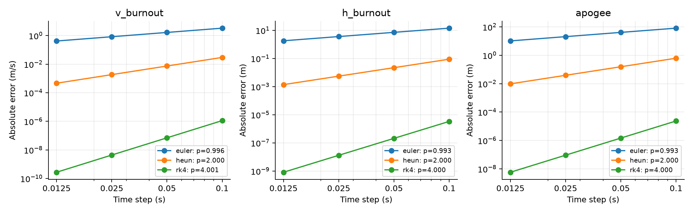
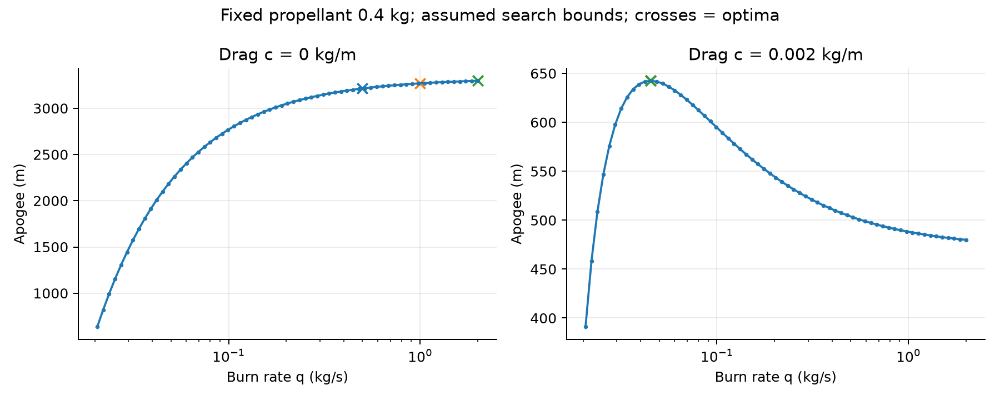

# C5 • Model Rocket

## Model Rocket — Simulation and Verification

Independent reference report for Differential Equations, International University – VNUHCM. Requirements source: Quang Nguyen, Simulation Projects v1.0, October 2026, sections 1–5 and C5 on pages 10–11.

Authors: Phạm Công Anh (SESEIU24002); Nguyễn Đức Anh (SESEIU25003); Trần Trung Kiên (SESEIU24014); Trần Trung Kỳ (SESEIU24015); Lê Võ Anh Thư (SESEIU24024)

V3 integrates wmlab 0.1.1 from the supplied starter kit, with local verification, actual toolkit JSON reports and an official-format dataset. This English edition translates toolkit text; original and localized hashes are recorded separately. Numerical algorithms are unchanged. The starter ZIP contains no separate report answer template.

| Parameter | Value / unit |
| --- | --- |
| m0; mf | 1.0; 0.6 kg |
| q; ve | 0.2 kg/s; 500 m/s |
| g; c | 9.81 m/s²; 0 then 0.002 kg/m |
| h0; v0; tb | 0 m; 0 m/s; (m0−mf)/q = 2 s |

## Model and algorithms

Powered: h′=v, v′=q ve/m−g−c v|v|/m, m′=−q. Coast: h′=v, v′=−g−c v|v|/mf, m′=0. Euler, Heun and RK4 are implemented directly with NumPy. The last powered step lands exactly on tb; apogee is located by finding the zero of velocity.

| Quantity | No drag | c=0.002 kg/m |
| --- | --- | --- |
| v burnout (m/s) | 235.792812 | 172.271882 |
| h burnout (m) | 214.141564 | 183.592580 |
| Apogee (m) | 3047.895394 | 544.419764 |
| t apogee (s) | 26.035965 | 8.999454 |

Baseline: RK4, Δt=0.02 s. Drag reduces apogee by 2503.476 m (82.14%). These are constant-c model results; they have not been validated against measured flight data.

# 1 • Analytical solutions and references

During burn: m=m0−qt; v=v0+ve ln(m0/m)−gt. Substituting u=m0−qs in the velocity integral gives ∫ ln[m0/(m0−qs)] ds = t−(m/q)ln(m0/m).

Hence h=h0+v0t+ve[t−(m/q)ln(m0/m)]−gt²/2. During no-drag coast: v=vb−gτ, h=hb+vbτ−gτ²/2, τa=vb/g, ha=hb+vb²/(2g). Reference values are calculated from these formulas rather than hardcoded as output.

| Published | Analytical | Absolute error | Error (%) | Tol / unit |
| --- | --- | --- | --- | --- |
| 235.8 | 235.792811883 | 0.00718812 | 0.0030484 | 0.05 m/s |
| 214.1 | 214.141564351 | 0.0415644 | 0.0194135 | 0.05 m |
| 3048.0 | 3047.895393897 | 0.104606 | 0.00343196 | 0.5 m |

These differences reflect rounding in the catalogue. Numerical error is measured against full-precision analytical values, not the rounded landmarks 235.8, 214.1 and 3048 treated as arbitrarily precise truth.

| RK4, dt=0.02 s | Absolute error | Relative error | Unit |
| --- | --- | --- | --- |
| h_burnout | 5.373e-09 | 2.509e-11 | m |
| v_burnout | 1.791e-09 | 7.594e-12 | m/s |
| apogee | 3.761e-08 | 1.234e-11 | m |

## Independent drag cross-check

Let k=c/mf. During upward coast: τa=arctan(vb√(k/g))/√(gk); ha−hb=ln(1+k vb²/g)/(2k). The k→0 limit recovers the no-drag formulas. If hb,vb come from the simulator, this check verifies only the coast phase.

The entire drag trajectory is also compared with SciPy DOP853 using states h,v and algebraic mass. Its RHS is written independently and does not call rocket.rhs or the reference RK4 implementation. rtol=atol=2×10⁻¹². Regression tests also compare a 10⁻¹⁰ tolerance solution to assess reference sensitivity.

RK4 error against DOP853: v_burnout = 6.681e-08 m/s; h_burnout = 1.847e-08 m; apogee = 1.588e-07 m.

# 2 • Measured convergence

E(Δt)=|Qnum−Qexact|; p=ln(Ei/Ei+1)/ln(Δti/Δti+1). A log E versus log Δt fit uses four steps: 0.1, 0.05, 0.025 and 0.0125 s for the same no-drag baseline. Local acceptance: |p−p_theory|≤0.35. Errors near roundoff are excluded; insufficient data give INCONCLUSIVE.

| Method | p theory | p(vb) | p(hb) | p(apogee) |
| --- | --- | --- | --- | --- |
| euler | 1 | 0.99630 | 0.99307 | 0.99322 |
| heun | 2 | 1.99993 | 1.99993 | 1.99996 |
| rk4 | 4 | 4.00114 | 3.99987 | 4.00008 |

| Δt (s) | Euler |ehb| (m) | Heun |ehb| (m) | RK4 |ehb| (m) |
| --- | --- | --- | --- |
| 0.1 | 1.43188e+01 | 8.88755e-02 | 3.35560e-06 |
| 0.05 | 7.21940e+00 | 2.22214e-02 | 2.09839e-07 |
| 0.025 | 3.62484e+00 | 5.55550e-03 | 1.31159e-08 |
| 0.0125 | 1.81622e+00 | 1.38889e-03 | 8.19455e-10 |

Euler/Heun/RK4 have one-step local errors O(Δt²), O(Δt³), O(Δt⁵) and global errors O(Δt), O(Δt²), O(Δt⁴). The measured results test these predictions. Full tables also include pairwise orders and relative errors.

Separate the phases at the thrust discontinuity: every stage of the last burn step still uses the powered RHS. Apogee bisection recomputes fractional steps from the same left state. Linear event interpolation, missing burnout, large non-asymptotic steps or very small roundoff-limited steps can reduce the measured order.

wmlab measures at a fixed time of 1.5 s, using h=0.1, 0.05, 0.025 s: euler: p=0.988516; heun: p=1.999868; rk4: p=3.999388. This is a smooth interval before burnout. Raw JSON reports are in convergence/wmlab/. The local study also checks burnout/apogee; the two studies use different metrics and horizons.

# 3 • PASS/FAIL, bounds and reliability

| Scenario wmlab | Actual | Expected | Demonstration |
| --- | --- | --- | --- |
| c5_baseline_drag | PASS | PASS | PASS |
| c5_analytic_no_drag | PASS | PASS | PASS |
| c5_euler_coarse_fail | FAIL | FAIL | PASS |

Pytest: 172/172 passed; failures=0, errors=0, skipped=0. Source: outputs/pytest.xml. Tests cover all three methods, non-divisible burnout steps, parameter changes, mass bounds/law, events, formulas, the zero-drag limit, convergence, adapters, datasets and time-rounding regressions.

Euler with Δt=0.5 s: vb error=15.928685 m/s, allowed=0.010236 m/s. The named v_burnout check must FAIL. This demonstrates large global error, which does not by itself prove instability. Unexpected exceptions do not count as a successful demonstration.

Bounds: m≥mf (tolerance 10⁻¹⁰ kg); m=m0−q min(t,tb); constant coast mass; increasing time; nondecreasing ascent altitude; |v_apogee|≤10⁻⁸ m/s; burnout at tb with acceleration jump qve/mf. Positive mass is physical; constant q and stopping at apogee define the model scope.

V2 compares every h,v,m sample with analytical/DOP853 references; checks h′,v′,m′ with phase-specific secants and a with the force equation. Clean trajectories passed: 2/2; detected 16/16 h/v/m/a mutations during burn and coast, with events preserved. Derivative tolerances combine reference stencil error, propagated state error and roundoff; intervals next to burnout are retained. Maximum absolute/relative errors and verdicts: trajectory_verification.csv/json. Tolerance derivation: docs/TRAJECTORY_VERIFICATION_EN.md.

## Time-step study with drag

| Method / Δt(s) | Apogee error (m) | max |R| | Local verdict |
| --- | --- | --- | --- |
| euler / 4 | 269.3 | 1 | FAIL accuracy/bounds |
| euler / 0.5 | 49.376 | 1 | FAIL accuracy/bounds |
| euler / 0.05 | 4.1643 | 1 | FAIL accuracy/bounds |
| heun / 4 | 336.03 | 4.13 | FAIL accuracy/bounds |
| heun / 0.5 | 4.9197 | 1 | FAIL accuracy/bounds |
| heun / 0.05 | 0.034717 | 1 | PASS |
| rk4 / 4 | 110.9 | 8.63 | FAIL accuracy/bounds |
| rk4 / 0.5 | 0.086456 | 1 | FAIL accuracy/bounds |
| rk4 / 0.05 | 6.3437e-06 | 1 | PASS |

This table requires apogee error≤0.05 m and passing physical bounds. λ=−2c|v|/m, z=λΔt; R is the method stability polynomial. max|R|>1 indicates amplification in a frozen linearization, not a theorem for the full nonlinear system. Guards reject 8 s steps for Heun/RK4; see the CSV.

# 4 • Burn rate and peak acceleration

Fixed propellant: 0.4 kg. Immediate liftoff requires q>m0g/ve=0.019620 kg/s. The lower bound is 0.020601 kg/s (an assumed 5% thrust margin), with upper bounds 0.5, 1 and 2 kg/s. These are numerical study domains, not supplied motor specifications.

| c (kg/m) | q_max | q* (kg/s) | Apogee (m) | Location |
| --- | --- | --- | --- | --- |
| 0 | 0.5 | 0.5000000 | 3214.1338 | upper boundary |
| 0 | 1 | 1.0000000 | 3269.5466 | upper boundary |
| 0 | 2 | 2.0000000 | 3297.2530 | upper boundary |
| 0.002 | 0.5 | 0.0450925 | 642.4119 | interior |
| 0.002 | 1 | 0.0450925 | 642.4119 | interior |
| 0.002 | 2 | 0.0450925 | 642.4119 | interior |

With drag: candidate q*≈0.045093 kg/s gives ha≈642.412 m, with little sensitivity to the three upper bounds. Halving dt changes ha by 1.85e-08 m; DOP853 differs by 1.97e-08 m. Scan 65 points per domain, refine detected peaks and compare both boundaries; global optimality is not guaranteed. The no-drag maximum is at the upper boundary, not a finite global optimum.

| Baseline | max |a|/g | max a/g | max |a+g|/g |
| --- | --- | --- | --- |
| c=0 | 15.98947 | 15.98947 | 16.98947 |
| c=0.002 | 11.08413 | 9.84099 | 10.84099 |

a=dv/dt is coordinate acceleration; a+g is proper acceleration. Both burnout limits are included. Within-step extrema are estimates; see peak_acceleration.csv. During no-drag coast, a=−g while proper acceleration is zero.

# 5 • wmlab, handoff and limitations

## Using this framework as Member C

From the project root, run python -m pip install -r requirements.txt; wmlab is installed from vendor/starter_kit/wmlab. Run python main.py report to reproduce tests, local checks, wmlab, both datasets, tables, figures and the PDF. python -m scripts.package creates the English ZIP. Read docs/MEMBER_C_HANDOFF_EN.md and WMLAB_INTEGRATION_EN.md.

A replacement simulator needs an adapter (params,dt,method)→Trajectory: increasing t; y columns h,v,m; acceleration in SI; actual burnout/apogee events and both acceleration limits. Pass simulator=adapter to run_scenario or convergence_study. Do not fill missing team-simulator events from the reference solution.

## Toolkit integration and evidence

c5_rocket.py implements simulate(p,init,t_span,dt), analytic, quantities, sample and EXTRA_CHECKS. Two scenarios pass and the deliberate failure is detected; three convergence reports pass. Actual wmlab run_checks detects 12/12 h/v/m mutations. The toolkit exports only h,v,m, so it cannot independently check an unexported acceleration channel. V2 still checks a through Trajectory.

wmlab 0.1.1 can exit with code 0 when checks fail; the runner reads passed_all and individual JSON checks. Built-in convergence has only a lower acceptance bound, so the runner also requires finite orders close to theory. Localization changes text, not these checks. system_card.yaml follows the supplied template and receives measured orders from the reports.

wmlab dataset creates c5_rocket.npz: shape=(200, 201, 3), seed=20261027, stride=1, dt=0.02 s. These are 200 common-time ascent segments on [0,4] s, without padding or treating the final time as apogee. All 200 segments were independently checked. Maximum h/v/m errors: 2.69e-07 / 1.76e-07 / 1.40e-14 (m / m/s / kg).

The supplementary local_dataset_200.npz retains 200 full ascents to apogee of differing lengths; 200 pass physical bounds. Assumed sampling domains: m0=0.8–1.2 kg; fuel fraction=0.25–0.45; ve=400–550 m/s; thrust/weight=1.2–15; c=0–0.003 kg/m. This is not a measured equipment distribution.

## Limitations and disclosure

1D ascent with constant g,q,ve,c; no wind, density variation, rail, launch angle or descent. Inputs qve≤m0g are rejected because contact and delayed liftoff are outside scope. Reducing dt can reduce numerical error but cannot remove modeling error. No measured flight data are available for experimental validation.

AI assistance: OpenAI Codex assisted with code, mathematical reasoning, tests, analysis, documentation and English translation. The student team is responsible for understanding and checking the submitted work. This disclosure is included in the report. The project retains consent_physeval=false.

## Sources and runtime environment

[1] Quang Nguyen, Differential Equations – Simulation Projects v1.0 (October 2026), pages 2–4 and 10–11, supplied PDF. [2] Official SciPy solve_ivp documentation: https://docs.scipy.org/doc/scipy/reference/generated/scipy.integrate.solve_ivp.html. Mathematical derivations and verification design are in docs/.

Python 3.13.14; numpy 2.5.0; scipy 1.18.0; matplotlib 3.11.0; pytest 9.1.1; PyYAML 6.0.3; reportlab 5.1.0; wmlab 0.1.1. Check details and versions are in summary.json; dependency pins are in requirements-tested.txt.
